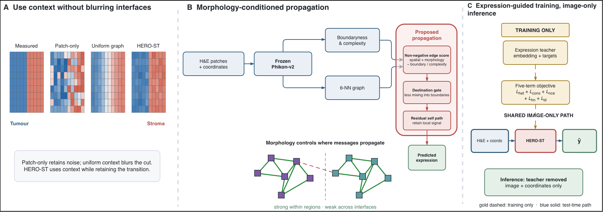

# HERO-ST

HERO-ST predicts spatial gene expression from H&E image patches while making
spatial message passing conditional on local morphology. This repository is
the compact code release for the manuscript model (**lite5**): core package,
training / evaluation entry points, final cohort configs, and a synthetic
smoke test. Experimental archives, comparison methods, raw data, and
checkpoints are intentionally excluded.

## Model overview



Figure 1. HERO-ST overview: morphology-conditioned spatial propagation with an
image-only test-time path.

### Inference path (image-only)

1. Frozen Phikon-v2 encoder and a trainable projection (`tiny_cnn` in smoke
   tests).
2. Morphology-conditioned graph propagation: non-negative edge scores, a
   monotone destination gate, residual self path, two message-passing layers.
3. Image-only expression head (mean and log-variance).

### Training path (expression teacher + five losses)

Measured expression is used **only while training**. An always-on privileged
expression teacher supplies consistency and embedding targets; it is removed
at inference. The manuscript objective has exactly five terms:

| Term | Role | Default weight |
| --- | --- | ---: |
| Heteroscedastic NLL | Fit expression with uncertainty | 1 (implicit) |
| Teacher consistency | Pull image prediction toward teacher mean | 1.0 |
| InfoNCE | Align image and expression embeddings | 0.5 |
| Boundary hard-negative | Push apart discontinuous neighbour pairs | 1.0 |
| Local-difference (`L_ld`) | Preserve expression jumps on graph edges | 4.0 |

Only these five terms are implemented in the released training loop.

## Quick start

Python 3.10 or newer is required. The smoke test uses a small CNN instead of
Phikon-v2, synthesizes its own slides, and runs on CPU without network access.

```bash
git clone https://github.com/chenxofhit/HeroST.git
cd HeroST
python -m venv .venv
source .venv/bin/activate
python -m pip install --upgrade pip
python -m pip install -e '.[test]'
pytest -q
python -m heroST.train --config configs/smoke_test.yaml --output outputs/smoke
python -m heroST.evaluate \
  --config configs/smoke_test.yaml \
  --checkpoint outputs/smoke/model.pt \
  --output outputs/smoke-eval
```

Training writes `model.pt`, `manifest.json`, `report.json`, and per-slide test
metrics under the output directory. Generated outputs are ignored by Git.

## Real-data runs

Install the real-data extras first:

```bash
python -m pip install -e '.[real-data]'
```

Manuscript configurations (same five-loss recipe):

- `configs/kidney_visium_sccrcc_lite5_v1.yaml` — primary Kidney ccRCC cohort
- `configs/her2_breast_real_lite5_v1.yaml` — HER2 breast
- `configs/brain_visium_epm_lite5_v1.yaml` — Brain EPM

Example:

```bash
python -m heroST.train \
  --config configs/kidney_visium_sccrcc_lite5_v1.yaml \
  --output outputs/kidney-seed0
```

Real-data experiments use selected samples from the gated
[`MahmoodLab/hest`](https://huggingface.co/datasets/MahmoodLab/hest) dataset.
Accept the provider's terms and set `HF_TOKEN`, or set
`HEROST_HEST_LOCAL_ROOT` to a local mirror with this layout:

```text
metadata/<sample-id>.json
patches/<sample-id>.h5
st/<sample-id>.h5ad
```

Phikon-v2 weights are downloaded from
[`owkin/phikon-v2`](https://huggingface.co/owkin/phikon-v2) on first use.
Set `HEROST_FEATURE_CACHE` to cache frozen CLS features across epochs.

Raw HEST data, access tokens, trained checkpoints, and cached image features
are not redistributed. Gene selection and expression normalization are fit on
training patients only; split IDs are checked for overlap before a run.

## Package layout

```text
heroST/
  models/     # encoder, gated graph, teacher head, five-loss objectives
  data/       # HEST loader, splits, synthetic smoke cohort
  eval/       # zone-stratified metrics and evaluation runner
  train.py    # training entry point
  evaluate.py # checkpoint evaluation entry point
configs/      # smoke + three lite5 manuscript configs
docs/         # Figure 1 overview image
tests/        # core forward / constrained-propagation checks
```

## Minimal Python inference example

```python
import torch
from heroST.models.hero_st import HeroSTConfig, HeroSTModel

cfg = HeroSTConfig(
    n_genes=32,
    embed_dim=64,
    backbone_name="tiny_cnn",  # use "phikon_v2" for manuscript runs
    m2_nonneg_weights=True,
    m2_monotone_gate=True,
    m2_boundary_penalty_mode="dst",
)
model = HeroSTModel(cfg).eval()

n = 16
patches = torch.rand(n, 3, 32, 32)
coords = torch.rand(n, 2)
src = torch.arange(n).repeat_interleave(2)
dst = torch.stack(
    (torch.roll(torch.arange(n), 1), torch.roll(torch.arange(n), -1)),
    dim=1,
).reshape(-1)
edge_index = torch.stack((src, dst))
edge_dist = torch.linalg.vector_norm(coords[src] - coords[dst], dim=1)

with torch.no_grad():
    prediction = model(patches, coords, edge_index, edge_dist).m3.mu
assert prediction.shape == (n, 32)
```

## Citation and license

Citation metadata are provided in `CITATION.cff`. No software license has been
declared; repository visibility alone does not grant reuse rights.
